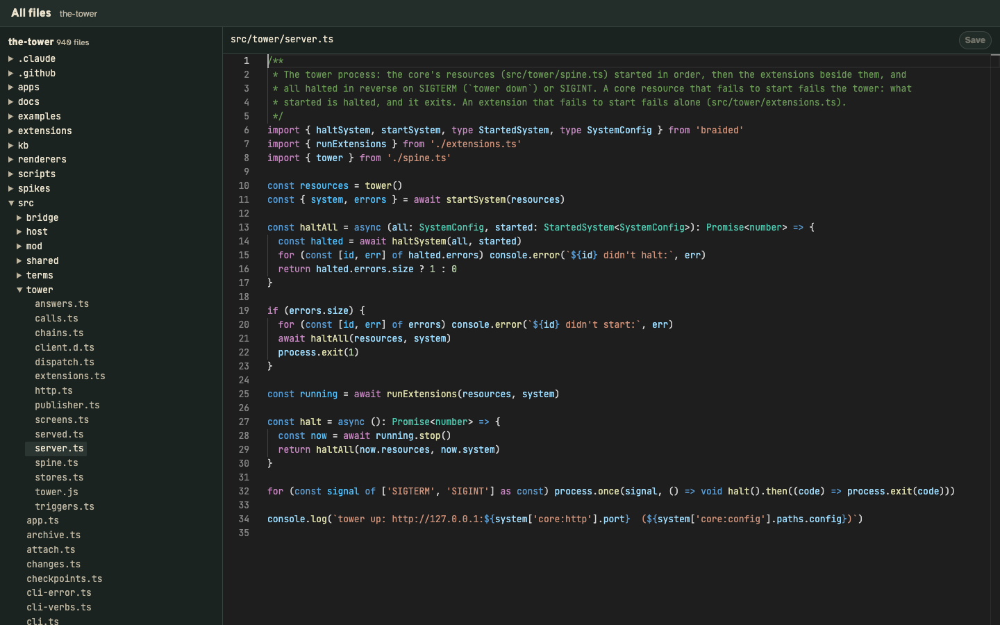

# tower-files

A file viewer for [the tower](https://github.com/RegiByte/the-tower), the local HQ for many Claude Code sessions: an extension (`extension.json`) and the "All files" pane, a renderer in `renderer/`
framed on a floor's shelf: everything in the floor's directories as a folding tree, what git ignores dimmed, and
the file picked open in
[Monaco](https://github.com/microsoft/monaco-editor), VS Code's editor, highlighted by [Shiki](https://shiki.style)
with VS Code's TextMate grammars and its Light+ / Dark+ themes (through `@shikijs/monaco`). Cmd/Ctrl+S saves.



## Build

`npm install && npm run build` bundles the pane into `renderer/out/` (git-ignored), so it loads nothing from the
network; `npm run build -- --watch` while working on it. `renderer/src/files.js` is the page.

## Settings

Set in the tower's config, for every floor under `extensions.files.settings`, and for one floor under
`projects.<id>.extensions.files.settings`, which overrides the first key by key (`tower config check` checks both):

```json
"extensions": { "files": { "path": "/abs/path/to/tower-files", "settings": { "editor": { "wordWrap": "on" } } } }
```

| Key | Takes | Unset |
|---|---|---|
| `editor.wordWrap` | `off`, `on` (at the editor's width), `wordWrapColumn` (at `wordWrapColumn`) or `bounded` (whichever comes first) | `off` |
| `editor.wordWrapColumn` | The column lines wrap at, under `wordWrapColumn` or `bounded` | `80` |

Each floor's are on the board as `floor.x.files.editor`, so an open pane follows an edit at once.

## The API

`GET /files/roots/<project>` names the floor's directories, its hub then its repos: `{ project, roots }`.
`GET /files/entries/<project>?dir=&path=` lists one folder of one (the top without `path`): everything in it but
`.git` and `.DS_Store`, node_modules too, folders first, each in name order, what git ignores marked:
`{ dir, path, entries: [{ name, kind: 'dir' | 'file', ignored? }] }`. The pane reads a folder when it is opened.
`GET /files/file/<project>?dir=&path=` reads one: `{ dir, path, size, version, lang, text?, binary?, truncated? }`,
`lang` the Shiki grammar its name calls for, the first 1 MB sent. `POST /files/write {project, dir, path, text, base}`
saves an existing file, refused when it changed since `base`, the `version` it was read at; `tower x files write
'<json>'` from a worker. Each takes only a directory of the floor and a path inside it.

A page reads them with `tower.get('files/entries/<project>?…')` and `tower.call('files/write', …)`; after editing `server.ts`, `tower extensions restart files`.

## Install

In `~/.tower/config.json`:

```json
"extensions": { "files": { "path": "/abs/path/to/tower-files" } },
"renderers": { "files": { "root": "/abs/path/to/tower-files/renderer", "settings": { "project": "my-app" } } },
"projects": { "my-app": { "shelf": [{ "label": "All files", "renderer": "files" }] } }
```

One renderer serves every floor: framed on a floor's shelf, the pane shows that floor's files, so each floor that wants
it adds the same shelf entry. `settings.project` is the floor it shows when opened on its own, at `/r/files/`.

`tower extensions check /abs/path/to/tower-files` reads the extension as the tower would.
